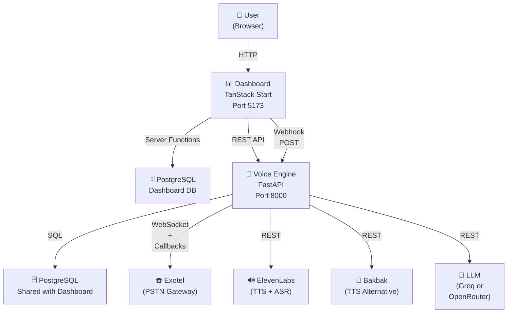
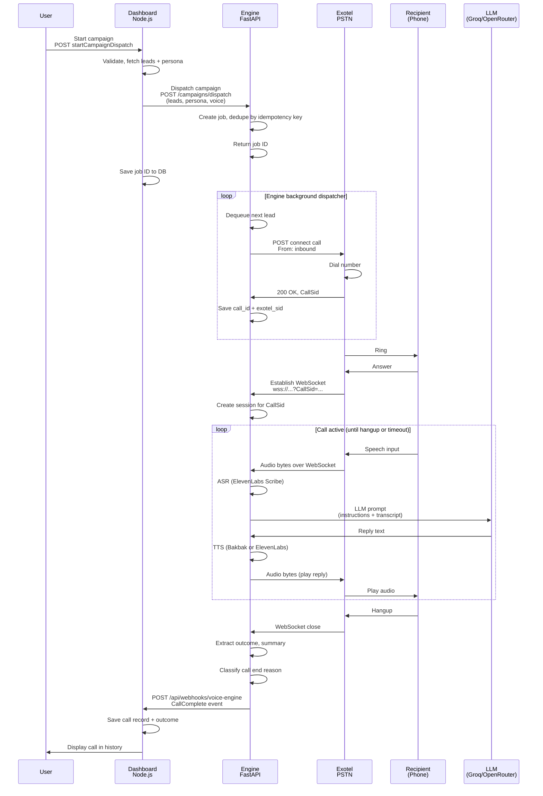
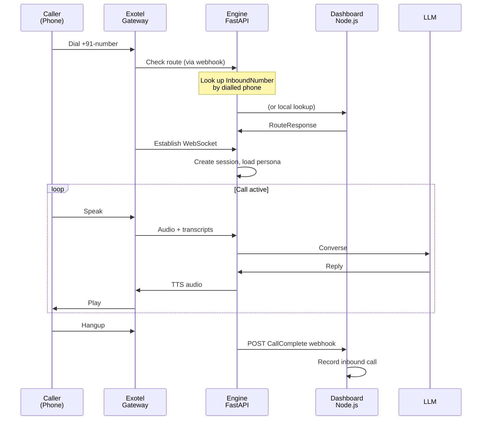
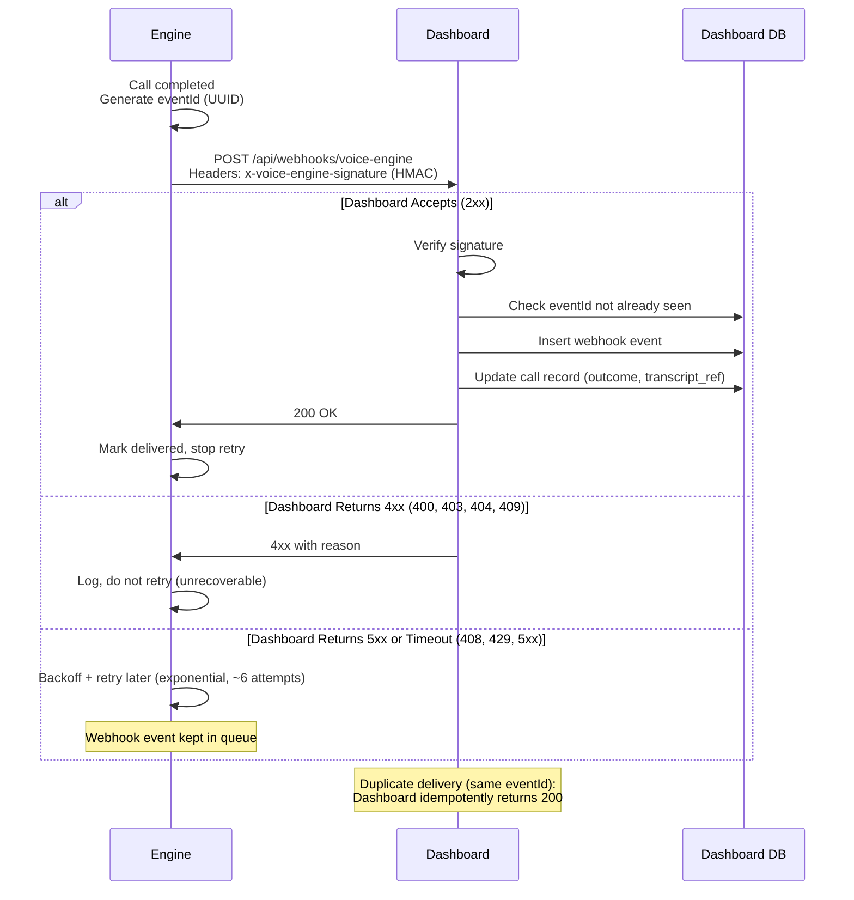
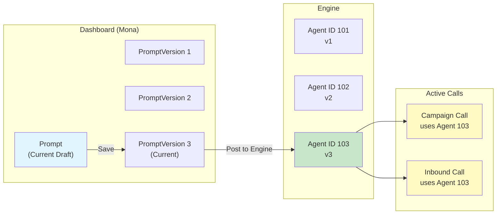

# System Architecture

## High-Level Component Diagram



## Network Topology

```
Public Internet
  │
  ├─ Exotel PSTN Gateway (public IP)
  │  └─ Calls from/to real phone numbers
  │
  ├─ Dashboard (VOICE_ENGINE_WEBHOOK_URL must be reachable)
  │  └─ Receives engine webhooks
  │
  └─ Engine (PUBLIC_BASE_URL must be reachable by Exotel)
     └─ Exotel calls this URL for WebSocket stream + status callbacks

Local (or Docker network)
  │
  ├─ TanStack Start dev server (localhost:5173)
  ├─ FastAPI engine (localhost:8000)
  └─ PostgreSQL (localhost:5434)
```

## Deployment Tiers

### Local Development
- Single machine: Dashboard, engine, PostgreSQL all on localhost
- No external PSTN; uses Exotel test account
- All process state in memory (no distributed sessions)

### Docker Compose (Local or Single-Server)
- Each service in a container
- Shared `bridge` network
- PostgreSQL in a named volume (persists across restarts)
- Exotel credentials from `.env`

### Production (Example: Cloud)
- Dashboard: Cloud-hosted static files (React build) + server-side functions on cloud runtime
- Engine: Containerized FastAPI on compute instance (e.g., Railway, AWS Lambda+SQS, GCP Cloud Run)
- Database: Managed PostgreSQL (Supabase, RDS, Cloud SQL)
- Telephony: Exotel on public IP; webhooks point to dashboard public URL
- LLM: Groq/OpenRouter rate-limited by paid API key

## Call Flow Sequences

### Outbound Call (Campaign Dispatch)



### Inbound Call (With Routing)



### Webhook Delivery (With Retry & Idempotency)



## Persona Versioning



## Call State Machine (Engine Side)

```mermaid
stateDiagram-v2
    [*] --> pending: Call initiated

    pending --> connecting: Dial Exotel
    
    pending --> failed: Dial failed immediately
    
    connecting --> active: Call answered
    
    connecting --> failed: Dial timeout<br/>or<br/>No answer
    
    active --> ended: Recipient hangup<br/>or<br/>Agent disconnect
    
    active --> failed: Network error<br/>during call
    
    failed --> [*]
    ended --> [*]
    
    note right of active
        WebSocket open
        ASR↔LLM↔TTS active
        State persisted to DB
    end
```

## Data Models Relationship Overview

### Dashboard Database (Prisma)

```
┌─────────────────┐
│      User       │
│   (Local Auth)  │
└────────┬────────┘
         │
         │ 1:N
         ↓
┌─────────────────────┐
│   ClientMember      │ ← Workspace membership
│ (User × Client)     │
└────────┬────────────┘
         │
         │ N:1
         ↓
┌─────────────────┐
│     Client      │ ← Multi-tenant workspace
│  (Workspace)    │
└────┬────┬──┬──┬─────────────────┐
     │    │  │  │                 │
     │    │  │  │ 1:N             │ 1:N
     │    │  │  └──→ Campaign     │ InboundNumber
     │    │  │       Lead ←─────┐ │
     │    │  │       Call       │ │
     │    │  │ 1:N              │ │
     │    │  └──→ Prompt        │ │
     │    │  │    PromptVersion │ │
     │    │  │                  │ │
     │    │  └──→ VoiceEngineJob│ │
     │    │                     │ │
     │    └─→ CreditTransaction │ │
     │                          │ │
     └──────→ CallOutcomeSettings
              (one per workspace)
```

### Engine Database (Hand-Written SQL)

```
agent
├── id (primary)
├── name, instructions, greeting, knowledge
├── language, workflow
├── outcome_rules[], outcome_fallback (JSON)
├── voice_id, tts_model_id
├── client_id (nullable; null = engine-wide default)
└── persona_key (unique per client; null = anonymous)

voice_engine_job
├── id (primary)
├── client_id, campaign_id (both from Dashboard)
├── engine_job_id (Exotel job reference)
├── status (pending, dispatched, running, completed, failed)
└── created_at, completed_at

inbound_route
├── phone (unique)
├── agent_id
└── active

call (shared with Dashboard)
├── id (primary)
├── engine_call_id (unique)
├── status, direction, duration_seconds
├── outcome (extracted by LLM)
└── outcome_raw (engine's raw classification)
```

## Request/Response Flow Example: Test Outbound Call

```
1. User clicks "Place test call" on dashboard
2. Browser: POST /api/test-outbound-call
   {
     personaKey: "my-persona",
     to: "+919876543210",
     contactName: "John Doe"
   }

3. Dashboard server fn (requireAuth + Zod validation):
   - Fetch persona by key + workspace
   - Resolve workspace client
   - Fetch outcome rules for workspace
   - POST to engine: /calls/test
   {
     client_id: "...",
     persona: { key, instructions, knowledge, ... },
     outcome_rules: [...],
     to: "+919876543210",
     contact_name: "John Doe"
   }

4. Engine:
   - POST /calls/test (no agent_id needed; uses persona snapshot)
   - Creates temporary agent from persona snapshot
   - Calls place_outbound_call (same as campaign dispatch)
   - Returns call ID immediately

5. Dashboard returns call ID to browser
6. Browser polls /api/calls/{callId} or subscribes to live updates
7. Engine dials, records call
8. Engine webhooks CallComplete back to dashboard
9. Dashboard displays call in "Recent Calls"
```

---

**See also:**
- [voice-pipeline.md](voice-pipeline.md) — Detailed voice processing flow
- [feature-flows.md](feature-flows.md) — Feature-specific sequences (campaigns, inbound routing, etc.)
- [integration-contracts.md](integration-contracts.md) — Message formats and contracts
